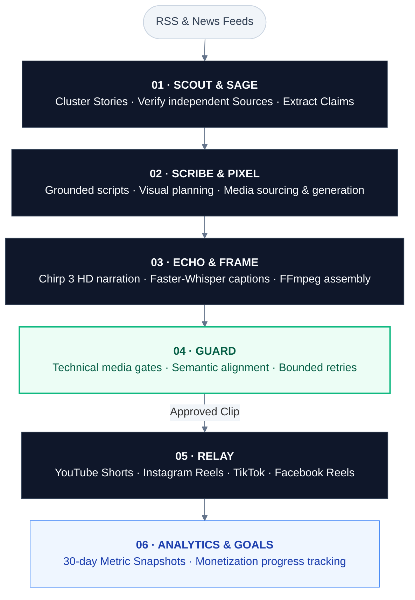

# ClipFactory

### Autonomous AI News Anchor & Short-Form Video Production Engine

[](https://github.com/lePuffin/ClipFactory/actions/workflows/ci.yml)


[](LICENSE)

ClipFactory is a production-grade autonomous content engine that converts verified global news and sports reporting into broadcast-quality vertical video (9:16 vertical Clips, 720×1280, 30 FPS). Built for hands-free daily publication to **YouTube Shorts**, **Instagram Reels**, **TikTok**, and **Facebook Reels**, ClipFactory enforces strict journalistic grounding—extracting primary sources, cross-verifying factual claims, and eliminating generative hallucinations before any script or media is produced.

---

## Key Highlights

- **Journalistic Evidence Grounding:** Discovers and clusters articles via RSS feeds, scores candidates against active editorial profiles, cross-references independent primary sources, and freezes verified claims with verbatim citations.
- **Autonomous Agent Personas:** Production is orchestrated by specialized agent personas—**Scout** (Research), **Sage** (Fact Grounding), **Scribe** (Script & Story), **Pixel** (Visual Assets), **Echo** (Voice & Audio), **Frame** (FFmpeg Composition), **Guard** (Quality Review & Retries), and **Relay** (Omnichannel Publishing)—with live telemetry streamed over Server-Sent Events (SSE).
- **Multi-Profile Scheduling:** Add, edit, enable or remove daily Run times from Content Profile. Each profile supports multiple times in the backend host's local timezone and an optional account credential prefix for separate publishing accounts.
- **Manual Dispatch:** Select a saved Content Profile on Overview before starting Run Now or Manual URL; manual selection does not change automatic schedules.
- **Hybrid Multi-Modal Media Pipeline:** Combines a local deduplicated media library, high-resolution open stock (Pexels, Pixabay, Unsplash, Wikimedia Commons), Wan 2.1 local video diffusion, HyperFrames programmatic infographics, and Manim animations.
- **Deterministic Broadcast Assembly:** Word-level subtitle timing via `faster-whisper`, speech synthesis via Google Cloud TTS (Chirp 3 HD), dynamic audio ducking, branded outro stings, and automated EU AI Act Article 50 disclosure overlays rendered via FFmpeg.
- **Automated Omnichannel Publishing & Analytics:** Automated dispatch across YouTube, Instagram, TikTok, and Facebook, backed by a 30-day analytics tracking lifecycle and real-time monetization milestone monitoring.
- **Automated Validation Gates & Targeted Retries:** Multi-layer evaluation covering audio/video technical gates, narrative pacing, and semantic claim fidelity with automated bounded revisions.

---

## Production Pipeline



---

## Architecture & Design Principles

ClipFactory is designed with strict separation of concerns using **Hexagonal Architecture (Ports and Adapters)**:

- **Zero Vendor SDK Leakage:** All external services (LLMs, TTS, news feeds, media stock, publishers) are isolated behind abstract interfaces (`ports/`). Business logic and workflows never directly couple to third-party SDKs.
- **Durable State & Resilience:** PostgreSQL provides ACID guarantees for domain entities, editorial profiles, and LangGraph workflow checkpoints. In-memory state and rolling rate-limits are backed by Dragonfly.
- **Deterministic Workflows:** Media processing, audio analysis, scheduling, routing, and verification gates are implemented entirely in deterministic code—LLMs are used exclusively for structured semantic synthesis.
- **Production Operational Console:** High-performance React 19 single-page application featuring live agent state, media review, timeline scrubber, centralized scheduling, and monetization goal tracking.

---

## Prerequisites

- **Linux / WSL2** (Ubuntu 22.04+ recommended)
- **Python 3.13+** with **[uv](https://docs.astral.sh/uv/)**
- **Node.js 22+** and **npm**
- **Docker** with Compose v2 (for PostgreSQL and Dragonfly services)
- **FFmpeg 6+** and **FFprobe** (compiled with `libx264`, `aac`, and `libass`)
- **System Graphics Libraries** (for Cairo/Pango text rendering): `libcairo2-dev`, `libpango1.0-dev`, `pkg-config`
- *(Optional)* **NVIDIA GPU with CUDA 12+** for accelerated local Wan 2.1 video diffusion and Whisper transcription

---

## Quickstart

### 1. Environment Configuration

```bash
cp .env.example .env
```

Configure your local database paths, storage directories, and provider keys in `.env`. Providers default to test fakes when credentials are left empty, enabling complete offline execution.

### 2. Dependency Installation & Build

```bash
# Backend dependencies and virtualenv setup
uv sync --locked

# Frontend compilation and assets build
cd frontend && npm ci && npm run build && cd ..
```

### 3. Bootstrap & Verification

```bash
# Start Docker services (PostgreSQL & Dragonfly), run migrations, seed initial profiles
uv run clipfactory setup

# Run preflight system health checks (Database, Dragonfly, FFmpeg, directories)
uv run clipfactory doctor

# Launch native backend server and scheduler daemon
uv run clipfactory
```

The web dashboard is served at `http://127.0.0.1:8000/`. Health check endpoint: `http://127.0.0.1:8000/api/health`.

### CLI Utilities

- `uv run clipfactory branding branding/<profile-slug>`: Generate a profile's reusable outro image, voice and video from its two logos. The Profile page shows its folder. See [profile branding](branding/README.md).
- `uv run clipfactory wan-test`: Benchmark local Wan 2.1 video generation.
- `uv run clipfactory db upgrade`: Apply pending Alembic database migrations.
- `uv run clipfactory serve`: Run Uvicorn directly with development live-reload.

---

## Quality & Verification

Every component is rigorously tested across unit, contract, integration, and end-to-end suites:

```bash
# Backend linting, type-checking, and test suite
uv run ruff check backend/
uv run pyright backend/
uv run pytest backend/tests/unit/

# Frontend linting, type-checking, and Vitest suite
cd frontend && npm run lint && npm run typecheck && npm run test && cd ..

# Full validation gate across backend, frontend, and architecture documentation
make check
```

---

## Architecture Documentation

| Document | Purpose |
| --- | --- |
| [doc/specifications/README.md](doc/specifications/README.md) | Canonical system specification and reading order |
| [doc/specifications/00-project-overview.md](doc/specifications/00-project-overview.md) | Production pipeline, scope, and engineering principles |
| [doc/specifications/architecture/README.md](doc/specifications/architecture/README.md) | System, application, workflow, and container architecture |
| [doc/specifications/decisions/README.md](doc/specifications/decisions/README.md) | Architecture Decision Records (ADRs) |
| [doc/specifications/24-acceptance-criteria.md](doc/specifications/24-acceptance-criteria.md) | Quality assurance and v1.0.0 acceptance criteria |
| [doc/setup/platform-credentials.md](doc/setup/platform-credentials.md) | Provider credentials and API integration guide |
| [AGENTS.md](AGENTS.md) | Core engineering contract and architectural rules |

---

## License

This project is licensed under the terms of the [MIT License](LICENSE).
